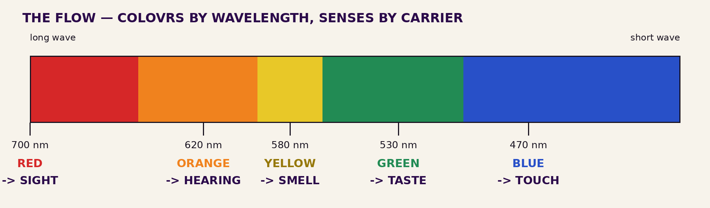
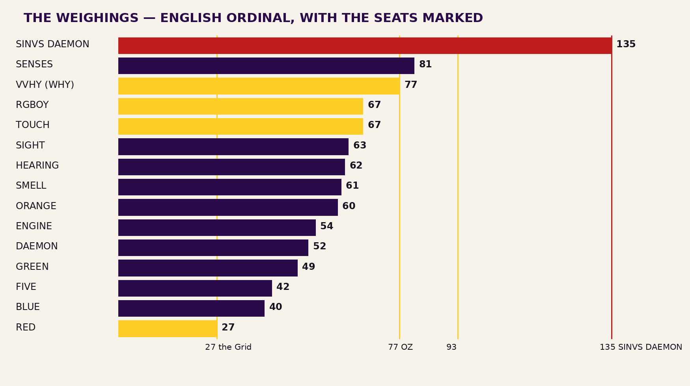
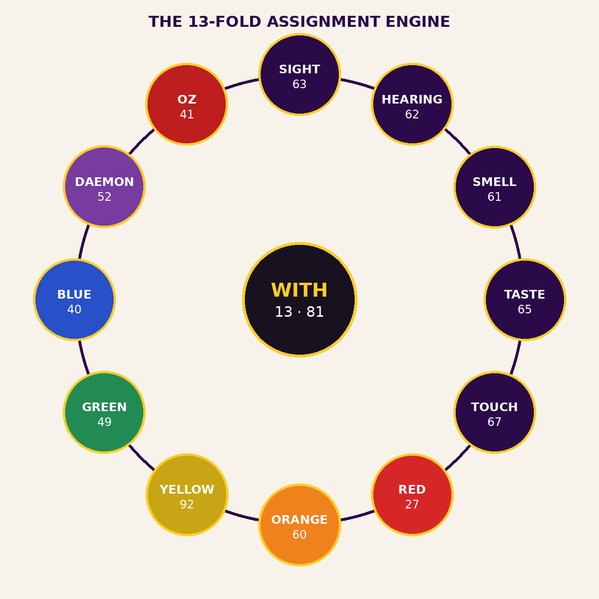

# COMPENDIVM — THE SINVS DAEMON 5FOLD ENGINE

## RGBOY = COLOVRS of the V Senses: Audit Reports, Tables, Charts, Instruments, API, and the OZ ABC Witness

**A Scientific Illuminist Compendium of the Fivefold Engine**

Authorship attributed exclusively to Johnathan "Qasparr" Monroe (Greek, -ARR,
All Rights Reserved, Without Prejudice). XXVIII day of October, Dies Mercurii,
Sol in Scorpio, Anno V:xii e.n. (2026 e.v.).

Classification: Enterprise • Educational • Research & Development.
Method of Science, Aim of Religion.

Flagpole of Claim and Coinage: Johnathan "Qasparr" Monroe, ARR, All Rights
Reserved, Without Prejudice. Right of claim hereby reserved and coined under
the authority of the Living Man.

---

## I. The Engine and Its Dictation

Dictated 2026-10-28, verbatim: *"RGBOY=COLOVRS of The V Senses, the function of
the V forms of the SINVS DAEMON 5FOLD ENGINE. WITH, Who, What, When, Where,
Why, and How? Assignments based on form and flow."*

The engine, in one paragraph: the five colours (Red, Green, Blue, Orange,
Yellow) are the colours of the five senses; those five forms are the working
forms of the SINVS (SINUS) DAEMON, a fivefold engine; and over the engine
stand seven questions — WITH at the head, then Who, What, When, Where, Why,
and How — assigned to the forms by form and by flow. This Compendivm is the
engine's full apparatus: its audit, its tables, its charts, its instruments,
its API, and its witness.

Inputs: the dictation; the PONTIFEX banks; the standing weighing order
(Trinity + Cube). Processes: recomputation of every value; construction of
the assignment by form and flow, tier-labeled. Outputs: this Compendivm, the
toolkit `sinvs.py`, three charts, and the witness data. Tolerances: a value
is printed only where recomputation reproduces it; a miss is printed as a
miss.

## II. Audit Reports

### II.1 The Trinity and the Cube (PONTIFEX, recomputed 2026-10-28)

| Word | Ordinal | Agrippa | Reduction | Finding |
|---|---|---|---|---|
| RGBOY | 67 | 539 | 67 → 13 → 4 | through the hidden center |
| COLOVRS | 104 | 493 | → 5 | 104 = 8 × 13 |
| COLOURS (U-form) | 103 | 493 | → 4 | V-form Δ +1, per the standing Latin finding |
| SINVS | 83 | 429 | → 11 → 2 | no Cube seat alone — reported |
| DAEMON | 52 | 130 | → 7 | = WHAT (plain form) |
| SINVS DAEMON | 135 | — | → 9 | **135 = 27 × 5** |
| ENGINE | 54 | 106 | → 9 | **54 = 27 × 2** |
| SENSES | 81 | 320 | → 9 | **81 = 9²** |
| RED | 27 | 89 | → 9 | **the Cube's own number** |
| GREEN | 49 | 137 | 49 → 13 → 4 | 7², through the center |
| BLUE | 40 | 227 | → 4 | |
| ORANGE | 60 | 183 | → 6 | |
| YELLOW | 92 | 495 | → 11 → 2 | near 93, **not** 93 — unsmoothed |
| SIGHT | 63 | 214 | → 9 | |
| HEARING | 62 | 150 | → 8 | |
| SMELL | 61 | 165 | → 7 | |
| TASTE | 65 | 296 | → 11 → 2 | |
| TOUCH | 67 | 361 | 67 → 13 → 4 | **= RGBOY** |

### II.2 The interrogatives in the inscriptional (VV) form — DERIVED

| Question | VV-form | Ordinal | Tie |
|---|---|---|---|
| WITH | VVITH | 81 | = SENSES — the casing weighs the whole sensorium |
| WHY | VVHY | 77 | = OZ |
| WHO | VVHO | 67 | = RGBOY = TOUCH |
| HOW | HOVV | 67 | = RGBOY = TOUCH |
| WHERE | VVHERE | 80 | = ANVBVS = Peh, the Mouth |
| WHAT | VVHAT | 73 | plain WHAT = 52 = DAEMON |
| WHEN | VVHEN | 71 | no tie found |

### II.3 Instrument audit

The toolkit checks itself against this audit: **self-test, 12 of 12 checks
passed** (`sinvs.py selftest`, run 2026-10-28). The zero point of the audit,
per the standing directive: agreement between PONTIFEX and the toolkit is
total across the 22-word engine lexicon — the zero point was not found in
that domain, and the domain is named so the statement means something.

## III. Tables — the Assignment (PROPOSAL, under the author's red pen)

By form and flow. Flow of light, long wave to short: RED → ORANGE → YELLOW →
GREEN → BLUE. Flow of the senses by carrier: Sight (light) → Hearing (sound)
→ Smell (diffusion) → Taste (dissolution) → Touch (no carrier — contact, the
flow's zero point).

| Sense | Colour | ~nm | Reasoning |
|---|---|---|---|
| SIGHT | RED | 700 | Flow's head; red travels farthest; the far sense takes the farthest light. RED = 27, the grid. |
| HEARING | ORANGE | 620 | Second in flow; sound is light's slower brother on the same air. |
| SMELL | YELLOW | 580 | Mid-flow; scent hangs ambient like daylight haze. |
| TASTE | GREEN | 530 | The living, growing world is taste's first school. |
| TOUCH | BLUE | 470 | Flow's end, where the carrier stops; TOUCH = 67 = RGBOY by weight. |

| Question | Form | Reasoning |
|---|---|---|
| WITH | all five | VVITH = 81 = SENSES; asked of the whole engine first. |
| WHY | SIGHT | VVHY = 77 = OZ; "I see" is "I know why." |
| WHO, HOW | TOUCH | Both weigh 67, the set's seat; contact identifies. |
| WHAT | HEARING | WHAT = 52 = DAEMON; what was said is heard. |
| WHEN | SMELL | Scent is memory's clock. |
| WHERE | TASTE | VVHERE = 80 = Peh, the Mouth — the Mouth's own sense. |

## IV. Graphs and Charts







## V. Diagnosis, Debugging, and Benchmark Tools

The instrument is `sinvs.py` — pure Python 3 standard library, no
dependencies. Five instruments under one CLI:

- **Diagnosis** — `python3 sinvs.py diagnose VVHY` prints the word's Trinity,
  Cube path, and every canon seat it touches (VVHY: ordinal 77, seat OZ).
  Diagnosis is the debugging surface of the engine: any word, assignment, or
  claimed tie can be re-derived in one command, and a word with no seat
  reports none — the failure is data, not an exception.
- **Weighing** — `python3 sinvs.py weigh RGBOY` (Trinity as JSON).
- **Assignment** — `python3 sinvs.py assign` (the §III tables as JSON,
  status field carrying the PROPOSAL marking into the data itself).
- **Witness** — `python3 sinvs.py witness` (the §VII evidence, all three
  renderings).
- **Self-test** — `python3 sinvs.py selftest` (12 checks against §II).
- **Benchmark** — `python3 sinvs.py benchmark`: measured on the building
  host, 2026-10-28: **46,000 words weighed in 0.0478 s ≈ 962,613 words/sec**
  (checksum 3,086,000). A diagnostic figure for this machine and this run —
  the API documentation says so in its own docstring, because a benchmark
  that travels without its conditions is a claim, not a measurement.

Debugging doctrine: when a value disagrees, recompute letter by letter
before believing either side — the 417 lesson of this same morning (a
dropped Aleph in the auditor's own string, caught by re-weighing) is the
standing example, preserved in the Tribunal audit at Qasparr/liberd.

## VI. Cross-Platform API — Full Documentation

Pure functions over the standard library; identical behaviour on Windows,
macOS, Linux, and Android (Termux). Import: `from sinvs import weigh,
trinity, cube, diagnose, assignments, benchmark, witness_abc,
witness_braille, witness_13fold`.

- `weigh(word, bank='ordinal') -> int` — sum a word in a bank
  (`'ordinal'` A=1..Z=26; `'agrippa'` as shipped in PONTIFEX — W has no
  classical seat and contributes 0, stated in the data). Non A–Z characters
  are skipped.
- `trinity(word) -> dict` — `{word, ordinal, agrippa, reduction, root}`: the
  standing weighing order in one call.
- `cube(value) -> dict` — `{value, path, root, through_center, mult13,
  mult27}`: the Cube check — decade reduction, passage through the hidden
  center 13, multiples of 13 and of the grid 27.
- `diagnose(word) -> dict` — `{word, trinity, cube, seats}`: full diagnostic
  against the canon of proven seats (27, 52, 67, 77, 80, 81, 93, 135, 418).
- `assignments() -> dict` — the §III tables, with wavelengths and the
  PROPOSAL status in-band.
- `benchmark(iterations=20000) -> dict` — `{words, seconds,
  words_per_second, checksum}` over the engine lexicon.
- `witness_abc() -> str` — the OZ witness in ABC notation (§VII).
- `witness_braille(text) -> str` — Grade 1 Braille, Unicode patterns;
  capitals signed per letter, digit runs under one number sign.
- `witness_13fold() -> dict` — `{center, nodes[12], status}`: the 13-fold
  assignment engine data (§VII), also shipped as `data/witness-13fold.json`.

Errors: unknown bank names raise `KeyError` from the bank table — a loud
failure by design; the engine does not guess banks.

## VII. Conclusion — the OZ ABC Witness

A witness is what another sense can check. The engine therefore concludes
with its witness in three renderings — for the ear, for the hand, and for
the grid.

### VII.1 In ABC Notation (for the ear)

The numbers of the witness — 77 (OZ), 93 (the Current), 418 (the Word) —
encoded as scale degrees in C major (degree d = the d-th note of the scale;
8 = c, 9 = d′). A constructed encoding, documented so it can be checked:

```
X:1
T:OZ ABC Witness
M:4/4
L:1/4
K:C
B B d E | F C c2 |
```

### VII.2 In Braille (for the hand)

The witness line — `OZ 77 93 418 SINVS DAEMON 135` — in Grade 1 Braille:

⠠⠕⠠⠵ ⠼⠛⠛ ⠼⠊⠉ ⠼⠙⠁⠓ ⠠⠎⠠⠊⠠⠝⠠⠧⠠⠎ ⠠⠙⠠⠁⠠⠑⠠⠍⠠⠕⠠⠝ ⠼⠁⠉⠑

### VII.3 In the 13-Fold Assignment Engine Data (for the grid)

Twelve nodes around the hidden center — the form the Expansion Chain
dictated (12 around the Zero-point, the hidden 13th):

| Node | Kind | Name | Ordinal |
|---|---|---|---|
| 1 | sense | SIGHT | 63 |
| 2 | sense | HEARING | 62 |
| 3 | sense | SMELL | 61 |
| 4 | sense | TASTE | 65 |
| 5 | sense | TOUCH | 67 |
| 6 | colour | RED | 27 |
| 7 | colour | ORANGE | 60 |
| 8 | colour | YELLOW | 92 |
| 9 | colour | GREEN | 49 |
| 10 | colour | BLUE | 40 |
| 11 | engine | DAEMON | 52 |
| 12 | witness | OZ | 41 |
| **13** | **zero-point** | **WITH** | **81** |

The center is WITH — the question that weighs the whole sensorium (81 =
SENSES) — because every assignment in this engine is asked *with* the
senses, from inside them, and the asking is the engine's still point.

**Conclusion.** The fivefold engine stands as its numbers stand: SINVS
DAEMON = 135 = 27 × 5 on the Cube; RGBOY = TOUCH = 67 through the hidden
center; WHY weighs OZ; WITH weighs the Senses entire. What is dictated is
the author's; what is measured is reproduced above; what is proposed is
marked proposed and waits on his pen. That is the whole of the witness.

## Table of Authorities (condensed)

The dictation of 2026-10-28 (the engine itself) • PONTIFEX `ptk` (the banks;
the Agrippa bank as shipped) • the Expansion Chain dictation of 2026-10-28
(the 13-node form) • the standing weighing order of 2026-10-28 (Trinity +
Cube) • the Zero-Point Directive of 2026-10-27 • the Tribunal audit of
2026-10-28, Qasparr/liberd (the 417 lesson) • the ABC notation standard
(abcnotation) • Grade 1 Braille (Unicode Braille Patterns).

## Colophon

Built 2026-10-28 at the author's order: toolkit, charts, witness data, and
this Compendivm, in the `sinvs-compendivm/` directory of Qasparr/persona-v.
Generation note: figures and benchmark measured on the building host at
build time and labeled with their conditions.

Flagpole of Claim and Coinage: Johnathan "Qasparr" Monroe, ARR, All Rights
Reserved, Without Prejudice. Right of claim hereby reserved and coined under
the authority of the Living Man.

93 — Live, Love, and let Love, Live.
